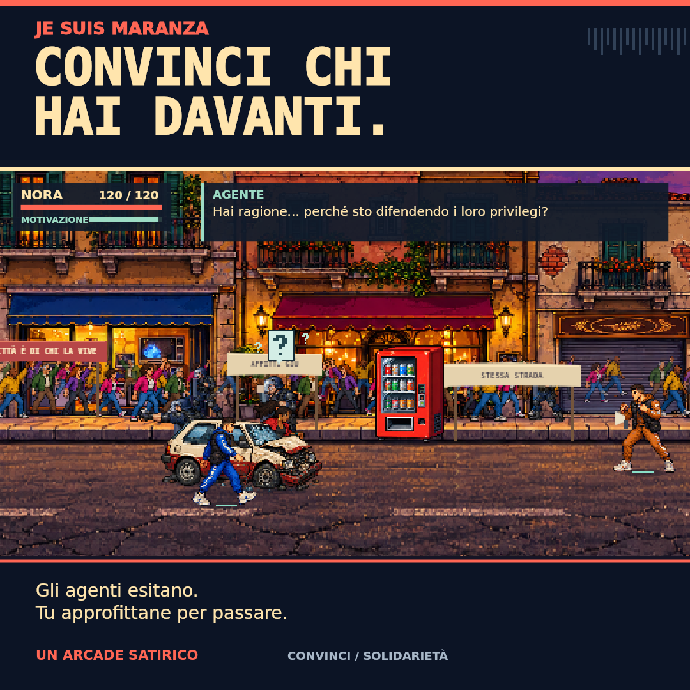

# Je suis Maranza

Arcade satirico in pixel art, versione 6.2.1. Sette atti dal quartiere popolare ai palazzi del potere, con Nora e Maranza alternati e due boss finali che fuggono illesi. I dialoghi sono finzione satirica.

<p align="center"></p>

<p align="center">
  
  
</p>

## Avvio locale

Serve Node.js 20 o successivo. Dalla cartella del progetto:

```sh
npm start
```

Apri http://127.0.0.1:8080. Non serve `npm install`: il progetto non ha dipendenze runtime. La cartella `dist` contiene già il gioco completo; non occorre compilarlo. L’apertura diretta di index.html con doppio clic può bloccare i moduli JavaScript: usa il server locale.

## Pubblicazione

Puoi caricare direttamente il contenuto di `dist` su un hosting statico, senza collegare GitHub. Segui [PUBBLICAZIONE.md](PUBBLICAZIONE.md) per Cloudflare Pages Direct Upload o itch.io. Il pacchetto web fornito separatamente ha già index.html alla radice.

## GitHub

Crea un repository vuoto, estrai questo archivio e carica il contenuto della cartella `je-suis-maranza`, mantenendo le sottocartelle. Sono inclusi codice, immagini, musiche e test; la cronologia Git e la configurazione del precedente hosting sono escluse. Non è presente alcuna pubblicazione automatica.

Per caricare con Git, dopo avere creato il repository, sostituisci l’URL nell’ultimo comando con quello del repository scelto:

```sh
git init
git add .
git commit -m "Initial release"
git branch -M main
git remote add origin URL_DEL_REPOSITORY
git push -u origin main
```

Per i file multimediali più grandi conviene Git da terminale o GitHub Desktop. GitHub può essere usato soltanto per custodire il sorgente; l’hosting resta indipendente.

## Regole e comandi

Raggiungi la fine di ogni scenario evitando manganellate e arresti. Gli oggetti sono facoltativi; romperli ricarica la motivazione per proteggersi e persuadere gli agenti. La polizia è immune agli attacchi del giocatore. Trump e il Presidente usano corazze meccaniche; quando cedono, i boss scappano e il corteo prosegue.

WASD/frecce per muoverti, J per gli oggetti, K tenuto per proteggerti, spazio per saltare e L per convincere. Su telefono sono disponibili joystick e pulsanti; è preferibile l’orientamento orizzontale. Musica ed effetti sono disattivabili dal menu.

## Verifica

```sh
npm run check
npm test
```

I test coprono le regole, i salvataggi e due campagne complete, con e senza distruzioni. Dettagli del bilanciamento in docs/qa-v12.md e della navigazione in docs/qa-v13.md.

## Struttura

- dist: gioco pronto per il web, compresi tutti gli asset.
- tests: test automatici eseguibili con Node.
- docs: provenienza grafica, verifiche e anteprime.
- scripts/serve.mjs: server locale senza dipendenze.

I salvataggi restano nel browser e sono legati all’indirizzo del sito. Cambiando hosting, i salvataggi del vecchio indirizzo non vengono trasferiti automaticamente.

Le immagini sono state create per il progetto; le due musiche sono state fornite dall’autore. Provenienza in docs/art-v3.md, docs/art-v4.md e docs/art-v10.md. Il progetto è distribuito secondo Apache License 2.0; consulta il file [LICENSE](LICENSE) per il testo integrale.
